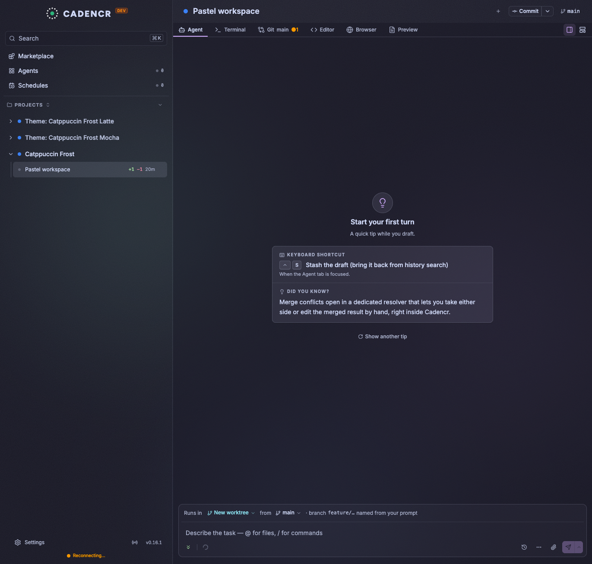
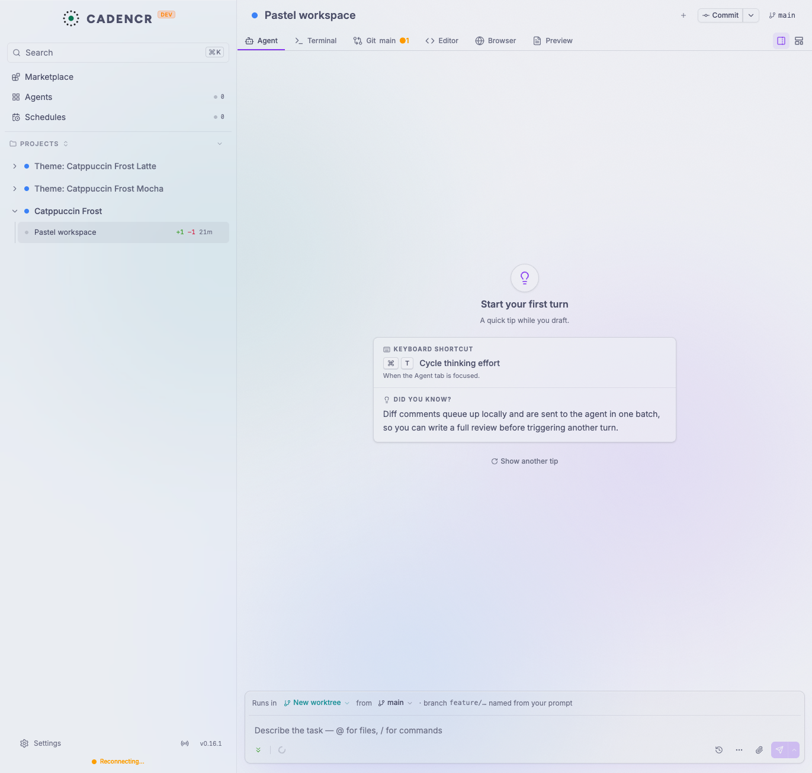

# Catppuccin Frost for CadencR

Catppuccin Mocha and Latte with three slowly drifting **teal, blue and mauve
halos**, a fine grain texture, and translucent workspace colors.

## Variants

| Theme | Appearance | Teal | Blue | Mauve |
| --- | --- | --- | --- | --- |
| Catppuccin Frost Mocha | Dark | `#94e2d5` | `#89b4fa` | `#cba6f7` |
| Catppuccin Frost Latte | Light | `#179299` | `#1e66f5` | `#8839ef` |

Both variants include complete UI, syntax, editor, diff and terminal palettes.
The terminal stays dark in both variants, using the Mocha ANSI colors.
CadencR controls the halo animation and honors reduced motion.

### Mocha



### Latte



## Install

Requires **CadencR 0.16.2 or newer**.

Once the registry contribution is accepted and published, open
**Marketplace → Themes**, install the desired variant, and choose
**Use this theme**. In **Settings → Appearance**, select Mocha for dark mode
and Latte for light mode to follow the system appearance.

To try the source before registry publication:

1. Duplicate a built-in theme in **Settings → Appearance**.
2. Open the resulting theme project.
3. Replace its `theme.json` with `themes/mocha/theme.json` or
   `themes/latte/theme.json`.
4. Check the theme's validation result and select it in the theme library.

## Portable theme format

Each release archive contains exactly one declarative `theme.json`: palette
tokens, the xterm palette, and the halo/grain geometry under `chrome.texture`.
There are no scripts, executables, dependencies or external image requests.

These portable themes carry the Frost ambient field and translucent colors.
CadencR's theme format does not accept arbitrary CSS, so the built-in Frost
theme's additional blur, shadows and component-specific material rules are
not part of these packages. The previews show the portable themes.

## Validate and package

Use the CadencR CLI version qualified by
[`cadencr-registry/ci/released-cli.env`](https://github.com/merkr-software/cadencr-registry/blob/main/ci/released-cli.env).
The initial release uses CLI `0.15.7`.

```bash
cadencr plugin validate themes/mocha --kind theme
cadencr plugin validate themes/latte --kind theme
sh scripts/package.sh dist
```

The packaging script refuses to overwrite existing archives. It writes two
exact-version `.tar.gz` files and prints their SHA-256 receipts. Each variant
is a separate marketplace theme, released together under `v0.1.0`.

## License and provenance

Licensed under [Apache-2.0](LICENSE).
The palette comes from [Catppuccin](https://github.com/catppuccin/palette)
(MIT); see [THIRD_PARTY_NOTICES.md](THIRD_PARTY_NOTICES.md).

The semantic palettes and Frost halo geometry derive from
[CadencR](https://github.com/merkr-software/CadencR/tree/aa31f5bd8cdad5bcb437cfe4ddd09e9e32073ed7),
with custom translucent colors and the teal/blue/mauve composition.
This is a community theme maintained by [edjubert](https://github.com/edjubert).
